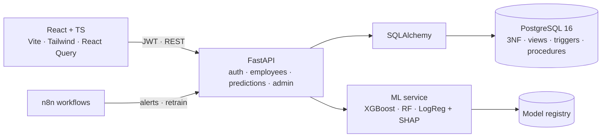

<div align="center">

# 🛡️ TalentGuard HR Analytics

**Predict who is likely to leave, explain why, and act on it before it happens**


[Features](#-features) · [Architecture](#-architecture) · [Quick start](#-quick-start) · [Docs](docs/) · [Türkçe](#-türkçe)

</div>

---

TalentGuard is an HR analytics platform that predicts **employee attrition (churn)** with machine
learning and explains every prediction with SHAP. It started as a Database Management Systems
course project, so the data layer is a carefully normalised PostgreSQL design. On top of it sit a
FastAPI backend and a modern React dashboard.

## ✨ Features

- **Churn prediction with explanations**: Logistic Regression, Random Forest and XGBoost are trained side by side; the best ROC-AUC wins and is activated. Each employee gets a risk score plus the **top SHAP risk factors**.
- **Model registry**: versioned models with metrics, retraining and one-click activation from the UI.
- **Role-based access control**: Admin, HR Specialist and Department Manager roles via JWT, with row-level filtering so managers only see their own department.
- **3NF PostgreSQL schema**: views, stored procedures, triggers and JSONB/GIN indexes.
- **Audit log**: triggers record every critical `INSERT`, `UPDATE` and `DELETE` at database level.
- **Dashboard**: KPIs, high-risk lists and charts (Recharts), with light and dark themes.
- **Automation**: n8n workflows for batch churn alerts and scheduled retraining (`n8n/`).

## 🧩 Architecture



## 🚀 Quick start

Requirements: Python 3.10+, Node 18+ and PostgreSQL 16.

```bash
# 1 · Database
createdb -U postgres churn_db

# 2 · Backend
cd backend
python -m venv venv && source venv/Scripts/activate   # Linux/macOS: source venv/bin/activate
pip install -r requirements.txt
cp .env.example .env
python -m scripts.init_db        # schema, views, triggers, procedures
python -m ml.train               # train models and activate the best one
uvicorn app.main:app --reload    # http://localhost:8000  (Swagger at /docs)

# 3 · Frontend
cd ../frontend
npm install
npm run dev                      # http://localhost:5173
```

On Windows, `START_ALL.bat` starts everything at once. A detailed guide is in [`docs/kurulum.md`](docs/kurulum.md).

### Demo accounts (local seed data)

| User | Password | Role |
|---|---|---|
| `admin` | `admin123` | Full access |
| `hr_user` | `hr123` | HR Specialist |
| `manager` | `manager123` | Department Manager |

## 📁 Project structure

```
backend/
├── app/        FastAPI app: api/, core/ (config, security, deps), models/, schemas/, db/
├── ml/         features, training, prediction (SHAP)
├── sql/        01_schema · 02_views · 03_triggers · 04_procedures
├── scripts/    init_db, seed_db
└── tests/      smoke tests (pytest)
frontend/src/   pages (Dashboard, Employees, Predict, ModelManagement, AuditLog, Users), components, lib
n8n/            churn-alert and retrain workflows
data/           IBM HR Analytics Attrition dataset
docs/           API, database schema, setup guide, project report
```

## 🇹🇷 Türkçe

**TalentGuard**, çalışanların işten ayrılma olasılığını makine öğrenmesiyle tahmin eden ve her tahmini
SHAP ile açıklayan bir İK analitik platformudur. Veritabanı Yönetim Sistemleri dersi projesi olarak başlamıştır:
3NF PostgreSQL şeması, view, saklı yordam, trigger ve denetim günlüğü içerir. FastAPI arka uç, React + TypeScript
arayüz, rol bazlı yetkilendirme (Admin, İK, Departman Yöneticisi), model kayıt sistemi ve n8n ile otomatik
uyarı/yeniden eğitim iş akışları sunar. Kurulum rehberi: [`docs/kurulum.md`](docs/kurulum.md).

---

<div align="center"><sub>Built by <a href="https://github.com/Soap2647">Mert Yasin Yılmaz</a> · Dataset: IBM HR Analytics Employee Attrition</sub></div>
